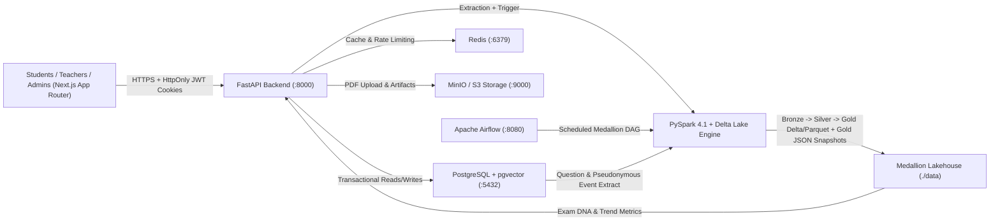

# EXAM X-RAY — System Architecture

> **Tagline:** *Don't Just Prepare. Understand the Examination.*

## 1. Architectural Overview

EXAM X-RAY is built as a modular, domain-driven monorepo separating transactional APIs, distributed PySpark Medallion analytics, pure intelligence engines, database schema/migrations, workflow orchestration, and a responsive Next.js App Router frontend.

## 2. Repository Layout

- `apps/api/` — FastAPI application (`app/main.py`), Pydantic v2 schemas, SQLAlchemy 2.0 cross-dialect models, JWT + RBAC security, and REST routers under `/api/v1`.
- `apps/web/` — Next.js 15 App Router frontend (TypeScript, Tailwind CSS, Recharts, Lucide React) with public pages, student workspace (`/dashboard/*`), teacher portal (`/teacher/*`), and admin workbench (`/admin/*`).
- `intelligence/` — Core intelligence engines:
  - `exam_dna/` — Exam DNA analytics & source provenance calculator
  - `question_similarity/` — 384-dim embeddings, 5-class relationship classification (`exact_duplicate`, `paraphrase`, `same_concept`, `same_pattern`, `difficulty_variation`), KMeans clustering
  - `trend_detection/` — Year-over-year weightage, Bloom/difficulty, competency & pattern shifts
  - `pattern_change/` — Official blueprint & rationalised syllabus diffs
  - `vulnerability_scanner/` — Mistake-pattern diagnosis, prerequisite propagation & explainable priority scoring
  - `paper_generator/` — Google OR-Tools CP-SAT constrained paper optimization + ReportLab PDF export
- `data-engineering/` — PySpark session factory, Bronze/Silver/Gold Medallion pipeline (`spark/medallion.py`), PDF + OCR ingestion (`ingestion/`), and Pandas vs. PySpark benchmark (`spark/benchmark.py`).
- `database/` — Alembic migrations (`migrations/`) and separate verified vs. synthetic seeders (`seed_data/`).
- `orchestration/` — Apache Airflow DAG (`exam_xray_medallion_dag.py`) scheduling automated Bronze->Silver->Gold runs.
- `infrastructure/docker/` — Dockerfiles (`api`, `web`, `spark`) and `docker-compose.yml`.

## 3. Data Provenance & Integrity Rules

1. **Verified vs. Synthetic Separation**: Every `data_source`, `question_paper`, and `question` carries `data_origin` (`verified_official`, `synthetic_dev`, `ai_generated`) and `verification_status`. Exam DNA analytics strictly query `verified_official` records unless an administrator explicitly requests synthetic benchmarks.
2. **No Fabricated Metrics**: Modules return explicit empty states (`verified_data_available = false`) whenever zero verified records exist for an exam/subject/period.
3. **Privacy by Design (DPDP Safeguards)**: Student analytical pipelines read only `analytics_pseudo_id` (`stu_<hex>`) and anonymized event metrics—zero PII enters the Bronze/Silver/Gold lakehouse. Students can export (`GET /api/v1/auth/me/export`) or delete (`DELETE /api/v1/auth/me`) their data.

## 4. Security Architecture

- **Authentication**: Passwords hashed via `bcrypt`; short-lived JWT access tokens (`30m`) and refresh tokens (`7d`) issued exclusively inside `HttpOnly`, `SameSite=Lax` cookies (plus `X-CSRF-Token` validation support).
- **RBAC**: `require_roles("admin")`, `require_roles("teacher", "admin")`, and student ownership checks protect every mutating endpoint.
- **Abuse Controls**: Rate limiting via `slowapi`, PDF magic-byte (`%PDF-`) validation, and SHA-256 deduplication on upload.
