# EXAM X-RAY — Database Schema & Entity-Relationship Architecture

EXAM X-RAY persists **34 transactional tables** in PostgreSQL (with `pgvector` `VECTOR(384)` support in production and cross-dialect SQLite compatibility for local development), managed via SQLAlchemy 2.0 + Alembic migrations (`database/migrations/`).

## Domain Groups

1. **Core Examination Registry (9 tables)**: `exam_bodies`, `exams`, `exam_versions`, `subjects`, `exam_subjects`, `syllabus_versions`, `syllabus_topics`, `topic_prerequisites`, `exam_blueprints`
2. **Question Intelligence (10 tables)**: `data_sources`, `question_papers`, `questions`, `question_options`, `question_answers`, `question_topics`, `question_embeddings`, `question_similarity`, `question_clusters`, `extraction_reviews`
3. **Student & Learning Analytics (8 tables)**: `users`, `student_exam_profiles`, `diagnostic_tests`, `diagnostic_test_questions`, `student_responses`, `student_topic_mastery`, `student_recommendations`, `learning_activity_events`
4. **Paper Generation (3 tables)**: `generated_papers`, `generated_paper_questions`, `paper_attempts`
5. **Operations & Governance (4 tables)**: `ingestion_jobs`, `processing_runs`, `audit_logs`, `model_versions`

## Mermaid Entity-Relationship Diagram

```mermaid
erDiagram
    exam_bodies ||--o{ exams : "governs"
    exams ||--o{ exam_versions : "has_versions"
    exams ||--o{ exam_subjects : "offers"
    subjects ||--o{ exam_subjects : "assigned_to"
    exam_subjects ||--o{ syllabus_versions : "defines_syllabus"
    exam_versions ||--o{ exam_blueprints : "specifies"
    exam_subjects ||--o{ exam_blueprints : "section_rules"
    syllabus_versions ||--o{ syllabus_topics : "contains"
    syllabus_topics ||--o{ syllabus_topics : "parent_topic"
    syllabus_topics ||--o{ topic_prerequisites : "requires"
    syllabus_topics ||--o{ topic_prerequisites : "prerequisite_for"

    data_sources ||--o{ question_papers : "proves_provenance"
    exams ||--o{ question_papers : "belongs_to"
    subjects ||--o{ question_papers : "covers"
    exam_versions ||--o{ question_papers : "version"
    syllabus_versions ||--o{ question_papers : "syllabus"
    question_papers ||--o{ questions : "contains"
    syllabus_versions ||--o{ questions : "aligned_to"
    question_clusters ||--o{ questions : "groups"
    questions ||--o{ question_options : "mcq_choices"
    questions ||--o{ question_answers : "official_key"
    questions ||--o{ question_topics : "tagged_with"
    syllabus_topics ||--o{ question_topics : "maps_to"
    questions ||--|| question_embeddings : "384d_vector"
    questions ||--o{ question_similarity : "source_q"
    questions ||--o{ question_similarity : "target_q"
    questions ||--o{ extraction_reviews : "human_qa"
    users ||--o{ extraction_reviews : "reviewed_by"

    users ||--o{ student_exam_profiles : "targets"
    exams ||--o{ student_exam_profiles : "targeted_by"
    users ||--o{ diagnostic_tests : "attempts"
    exams ||--o{ diagnostic_tests : "for_exam"
    subjects ||--o{ diagnostic_tests : "for_subject"
    diagnostic_tests ||--o{ diagnostic_test_questions : "includes"
    questions ||--o{ diagnostic_test_questions : "selected_in"
    diagnostic_tests ||--o{ student_responses : "records"
    users ||--o{ student_responses : "answers"
    questions ||--o{ student_responses : "answered"
    users ||--o{ student_topic_mastery : "mastery_state"
    syllabus_topics ||--o{ student_topic_mastery : "measured_on"
    users ||--o{ student_recommendations : "receives"
    syllabus_topics ||--o{ student_recommendations : "focuses_on"
    users ||--o{ learning_activity_events : "emits_pseudonymous"

    users ||--o{ generated_papers : "creates"
    exams ||--o{ generated_papers : "blueprint_exam"
    subjects ||--o{ generated_papers : "blueprint_subject"
    generated_papers ||--o{ generated_paper_questions : "contains"
    questions ||--o{ generated_paper_questions : "placed_in"
    generated_papers ||--o{ paper_attempts : "attempted_in"
    users ||--o{ paper_attempts : "taken_by"

    users ||--o{ ingestion_jobs : "uploaded_by"
    exams ||--o{ ingestion_jobs : "target_exam"
    subjects ||--o{ ingestion_jobs : "target_subject"
    users ||--o{ audit_logs : "actor"
```

## Key Integrity & Migration Guarantees

- **UUID Primary Keys**: Every entity uses RFC-4122 UUIDs via cross-dialect `GUID()` (`postgresql.UUID` on PostgreSQL, `CHAR(36)` on SQLite).
- **Soft Deletion**: Core entities (`exam_bodies`, `exams`, `subjects`, `syllabus_topics`, `question_papers`, `questions`, `users`) carry `is_deleted` + `deleted_at` columns.
- **Provenance & Uniqueness**: `question_papers` enforce `uq_paper_identity (exam_id, subject_id, year, set_code, data_origin)` and unique SHA-256 `document_hash`.
- **Migrations**: Managed via `alembic -c database/migrations/alembic.ini upgrade head`.
